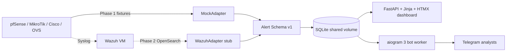

# NetworkSec Mini-SIEM

Mini-SIEM cho đồ án mạng doanh nghiệp mô phỏng: chuẩn hóa alert từ router, switch và
firewall; lưu SQLite; phân tích trên dashboard SOC; gửi cảnh báo Telegram có dedup,
rate limit, acknowledge và mute. Phase 1 chạy hoàn chỉnh bằng mock data thực tế;
`WazuhAdapter` được cố ý giữ là stub cho Phase 2.

## Kiến trúc



Ba container dùng cùng image multi-stage và chạy non-root: `dashboard`, `bot`, và
`mock` (profile on-demand). Tổng memory limit là 256 MB.

## Screenshots

> Placeholder: thêm ảnh **SOC Command Center**, **Alert detail** và **Telegram alert**
> vào `docs/screenshots/` trước buổi bảo vệ.

## Quick start

Yêu cầu: Docker Desktop/Engine có Compose v2 và một Telegram bot.

```bash
git clone https://github.com/QuocVinhTrinhLam/NetworkSec.git
cd NetworkSec && cp .env.example .env
# Điền TELEGRAM_BOT_TOKEN, ALLOWED_CHAT_IDS và đổi SESSION_SECRET trong .env
docker compose up -d --build dashboard bot
make scenario NAME=ssh_bruteforce
```

Mở `http://127.0.0.1:8000`. Tài khoản demo local là `admin` / `change-me-now`;
hãy tạo hash mới bằng `python -m app.password_hash` trước khi chia sẻ hệ thống.

## Tạo Telegram bot

1. Nhắn `@BotFather`, chạy `/newbot`, đặt tên và username.
2. Chép token vào `TELEGRAM_BOT_TOKEN`; không gửi token qua chat hoặc commit Git.
3. Gửi một tin cho bot, sau đó mở cục bộ
   `https://api.telegram.org/bot<TOKEN>/getUpdates` và lấy `message.chat.id`.
4. Điền một hoặc nhiều ID chat riêng của analyst vào `ALLOWED_CHAT_IDS`, phân cách
   bằng dấu phẩy. Không dùng ID group chung vì quyền lệnh được cấp theo chat ID.
5. Chạy `docker compose up -d bot` và kiểm tra `docker compose ps`.

Chat ngoài allowlist bị bỏ qua hoàn toàn; log chỉ ghi ID, không ghi nội dung gửi đến.

## Cấu hình môi trường

Tất cả cấu hình nằm trong `.env`; file này đã bị Git và Docker ignore.

| Biến | Mặc định | Mô tả |
|---|---|---|
| `APP_NAME` | `Network Security Monitor` | Tiêu đề dashboard |
| `APP_ENV` | `development` | `production` bật kiểm tra secret nghiêm ngặt |
| `APP_URL` | `http://localhost:8000` | URL cho nút Open dashboard |
| `BIND_HOST` | `127.0.0.1` | Interface host được publish; bind public bắt buộc đổi secret |
| `DASHBOARD_PORT` | `8000` | Cổng dashboard trên host |
| `DATABASE_PATH` | `./data/monitor.db` | SQLite local; Compose ghi đè |
| `LOG_LEVEL` / `JSON_LOGS` | `INFO` / `false` | Mức log và định dạng JSON |
| `ALERT_SOURCE` | `mock` | `mock` hoặc stub `wazuh` |
| `RAW_LOG_MAX_LENGTH` | `4096` | Giới hạn raw log trước lưu trữ |
| `ADMIN_USERNAME` | `admin` | Tên đăng nhập dashboard |
| `ADMIN_PASSWORD_HASH` | demo hash | PBKDF2-SHA256, không lưu password thô |
| `SESSION_SECRET` | placeholder | Secret cookie, tối thiểu 32 ký tự ở production |
| `SESSION_HTTPS_ONLY` | `false` | Bật sau HTTPS reverse proxy |
| `DEVICE_SILENT_MINUTES` | `15` | Ngưỡng alert thiết bị im lặng |
| `TELEGRAM_BOT_TOKEN` | trống | Token BotFather |
| `ALLOWED_CHAT_IDS` | trống | Allowlist chat riêng của analyst, phân cách dấu phẩy |
| `TELEGRAM_MIN_SEVERITY` | `medium` | Mức thấp nhất gửi Telegram |
| `TELEGRAM_TIMEZONE` | `Asia/Ho_Chi_Minh` | Timezone IANA trong tin nhắn |
| `NOTIFICATION_INTERVAL_SECONDS` | `2` | Chu kỳ đọc outbox |
| `DEDUP_WINDOW_SECONDS` | `60` | Cửa sổ gộp cùng dedup key |
| `MAX_MESSAGES_PER_MINUTE` | `20` | Giới hạn tin riêng toàn cục |
| `TELEGRAM_RATE_WINDOW_SECONDS` | `60` | Cửa sổ rate limit |
| `MOCK_MODE` / `MOCK_GENERATION_MODE` | `true` / `replay` | Nhãn demo và mode generator |
| `MOCK_FIXTURE_PATH` | `./fixtures/alerts.json` | Fixture alert chuẩn |
| `MOCK_RATE_PER_SECOND` | `0` | Tốc độ phát; 0 là tức thì |
| `MOCK_DURATION_SECONDS` | `60` | Khoảng thời gian mô phỏng |
| `MOCK_SCENARIO` | trống | Scenario mặc định tùy chọn |
| `MOCK_SEVERITY_DISTRIBUTION` | `low=40,...` | Trọng số random mode |
| `SCENARIO_NAME` / `SCENARIO_DURATION` | `ssh_bruteforce` / `60` | Make/Compose scenario |
| `WAZUH_INDEXER_URL` | `https://wazuh-indexer:9200` | URL Indexer ở VM riêng |
| `WAZUH_INDEX_PATTERN` | `wazuh-alerts-*` | Pattern Phase 2 |
| `WAZUH_USERNAME` / `WAZUH_PASSWORD` | trống | Tài khoản chỉ đọc qua `.env` |
| `WAZUH_VERIFY_TLS` | `true` | Luôn xác minh TLS |
| `WAZUH_CA_FILE` | trống | CA bundle được mount |
| `WAZUH_INITIAL_LOOKBACK_MINUTES` | `5` | Lookback lần đầu |
| `POLL_INTERVAL_SECONDS` | `10` | Chu kỳ source/watcher |
| `SEVERITY_CONFIG` | `./config/severity_map.yaml` | Mapping level → severity |
| `RULES_CATALOG` | `./config/rules_catalog.yaml` | Catalog use case |

## Lệnh Telegram

| Lệnh | Chức năng |
|---|---|
| `/start`, `/help` | Hướng dẫn nhanh |
| `/status` | Source health, alert cuối, DB, queue, uptime |
| `/last [n]` | Tối đa 20 alert gần nhất |
| `/top_sources` | Top source IP 24 giờ |
| `/stats` | Severity và device type 24 giờ |
| `/mute <rule_id> <minutes>` | Tắt thông báo rule |
| `/unmute <rule_id>` | Bỏ mute rule |
| `/ack <alert_id>` | Acknowledge alert |

Alert có nút **Acknowledge**, **Mute rule 1h** và **Open dashboard**. Callback
dùng prefix ngắn dưới giới hạn 64 byte của Telegram nhưng chỉ resolve khi duy nhất.

## Mock, scenario và seed

```bash
python -m app.mock --mode replay --rate 2
python -m app.mock --mode random --count 100 \
  --severity-distribution 'low=40,medium=35,high=20,critical=5'
python -m app.mock --scenario ssh_bruteforce --duration 60 --rate 0
make seed
```

Scenario: `ssh_bruteforce`, `port_scan`, `syn_flood`, `arp_spoof`,
`config_change`, `device_silent`. CLI luôn đi qua
`MockAdapter → normalizer → Alert v1 → IngestionPipeline → SQLite`.

## Docker và Wazuh VM

Wazuh không nằm trong Compose. Ở Phase 2, đặt `WAZUH_INDEXER_URL` thành DNS/IP mà
container truy cập được, tạo user Indexer chỉ đọc và mount CA bằng Compose override
vào đúng `WAZUH_CA_FILE`. Không tắt TLS verification trong deployment.

Build multi-architecture từ máy có builder hỗ trợ:

```bash
docker buildx build --platform linux/amd64,linux/arm64 \
  -f docker/Dockerfile -t your-registry/networksec:phase1 --push .
```

Base image và dependency không khóa theo CPU; builder chọn wheel phù hợp platform.

## Kiểm thử và chất lượng

```bash
make test
make lint
.venv/bin/pip-audit -r requirements.txt
docker compose config -q
```

Test bao phủ schema/ID deterministic, migration SQLite, mock modes/scenario, bot
escaping/dedup/rate/auth/callback, silent watcher, CSRF/XSS/CSV và dashboard. E2E
Playwright cần Chromium và quyền bind loopback.

## Cấu trúc dự án

```text
app/                API, web, schema, adapters, services và aiogram bot
config/             severity map và rules catalog song ngữ
fixtures/           alert JSON + log vendor thực tế
docs/               schema, catalog và demo script
tests/              unit, integration và Playwright E2E
docker/             multi-stage Dockerfile
docker-compose.yml  dashboard, bot và mock profile
```

## Khắc phục lỗi

- `bot` unhealthy: kiểm tra token/allowlist và `docker compose logs bot`; token sai
  sẽ không tạo `/tmp/bot.ready`.
- Dashboard trống: chạy `make seed` hoặc scenario, rồi chọn time range 7 ngày.
- Không có Telegram alert: kiểm tra severity threshold, mute và queue qua `/status`.
- `ALERT_SOURCE=wazuh`: Phase 1 ghi `not-implemented` nhưng không crash loop.
- SQLite locked: chỉ dùng shared named volume local, không đặt DB trên NFS.
- TLS/CA Wazuh: xác minh hostname, mount đúng CA và không log credentials.

## Bảo mật

- Log thiết bị là attacker-controlled: Pydantic validate/truncate, Jinja autoescape,
  Telegram escape và CSV chống formula injection.
- SQL parameterized; callback chỉ resolve prefix hex duy nhất.
- Container non-root, root filesystem read-only, drop capabilities, log rotation,
  bind localhost mặc định.
- Production từ chối session secret mặc định/ngắn. Không commit `.env`, token, CA
  private key, database hoặc log thật.

## Roadmap Phase 2

- Hiện thực `WazuhAdapter` bằng OpenSearch `search_after` trên `@timestamp` + `_id`.
- Bổ sung Suricata EVE JSON và heartbeat telemetry riêng.
- Active response có phê duyệt analyst, audit trail và rollback.
- PostgreSQL/Redis khi scale; SSO/RBAC và login throttling cho production.

Xem thêm [Alert Schema](docs/alert_schema.md),
[Rules Catalog](docs/rules_catalog.md) và [Demo script](docs/DEMO.md).
