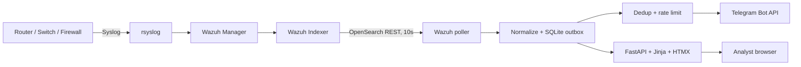

# Network Security Monitor

Dashboard cảnh báo nhẹ và Telegram bot dành cho đồ án giám sát router, switch và firewall. Ứng dụng nhận alert đã được Wazuh phân tích, chuẩn hóa về một schema chung, lưu trạng thái trong SQLite và chạy trong một tiến trình FastAPI. Mức sử dụng bộ nhớ của container được giới hạn ở 300 MB.

## Kiến trúc



Wazuh chịu trách nhiệm decoder và detection rule. Repository này chỉ đọc alert đã sinh; decoder/rule riêng cho pfSense, MikroTik và Cisco có thể bổ sung sau mà không thay đổi dashboard.

## Chạy nhanh bằng mock mode

Yêu cầu: Python 3.11+ hoặc Docker Desktop.

```bash
cp .env.example .env
docker compose up -d --build
docker compose exec monitor python -m app.mock_generator --count 18 --interval 0.2 --duplicate-every 4
```

Mở `http://localhost:8000`, đăng nhập bằng `admin` / `change-me-now`. Đổi mật khẩu và `SESSION_SECRET` trước khi chia sẻ hoặc triển khai.

Chạy trực tiếp khi phát triển:

```bash
python3 -m venv .venv
.venv/bin/pip install -r requirements-dev.txt
cp .env.example .env
.venv/bin/uvicorn app.main:app --reload --env-file .env
```

Tạo password hash mới:

```bash
.venv/bin/python -m app.password_hash
```

## Kết nối Wazuh

1. Đặt `MOCK_MODE=false`.
2. Điền `WAZUH_INDEXER_URL`, `WAZUH_USERNAME`, `WAZUH_PASSWORD`.
3. Giữ `WAZUH_VERIFY_TLS=true`. Nếu lab dùng CA tự ký, mount CA vào container và đặt `WAZUH_CA_FILE` tới đường dẫn đó.
4. Kiểm tra index pattern `wazuh-alerts-*` và chạy truy vấn mẫu trong [docs/sample-wazuh-query.json](docs/sample-wazuh-query.json).
5. Khởi động lại container và xem `/status` trên bot hoặc `/health` trên web.

Không dùng `WAZUH_VERIFY_TLS=false` trừ lúc chẩn đoán ngắn trong mạng lab cô lập.

## Telegram bot

1. Mở Telegram, trò chuyện với `@BotFather`, chạy `/newbot` và giữ token bí mật.
2. Gửi một tin nhắn cho bot mới. Truy cập `https://api.telegram.org/bot<TOKEN>/getUpdates` cục bộ để đọc trường `message.chat.id`.
3. Điền token vào `TELEGRAM_BOT_TOKEN` và danh sách ID, phân cách bằng dấu phẩy, vào `ALLOWED_CHAT_IDS`.
4. Khởi động lại ứng dụng. Chat không nằm trong allowlist bị bỏ qua hoàn toàn.

Lệnh: `/start`, `/help`, `/status`, `/last [n]`, `/top_sources`, `/stats`, `/mute <rule_id> <minutes>`, `/ack <alert_id>`.

## Biến môi trường

| Biến | Mặc định | Ý nghĩa |
|---|---:|---|
| `MOCK_MODE` | `true` | Không kết nối Wazuh khi demo độc lập |
| `DATABASE_PATH` | `/app/data/monitor.db` | SQLite bền vững |
| `ADMIN_USERNAME` | `admin` | Tài khoản dashboard |
| `ADMIN_PASSWORD_HASH` | — | PBKDF2-SHA256, không lưu mật khẩu thô |
| `SESSION_SECRET` | — | Khóa ký cookie phiên, tối thiểu 32 ký tự ngẫu nhiên |
| `SESSION_HTTPS_ONLY` | `false` | Đặt `true` khi chạy sau HTTPS proxy |
| `DEVICE_SILENT_MINUTES` | `15` | Ngưỡng thiết bị im lặng |
| `WAZUH_INDEXER_URL` | `https://wazuh-indexer:9200` | URL Wazuh Indexer |
| `WAZUH_INDEX_PATTERN` | `wazuh-alerts-*` | Index alert |
| `WAZUH_VERIFY_TLS` | `true` | Xác minh chứng chỉ TLS |
| `WAZUH_CA_FILE` | trống | CA tùy chỉnh cho chứng chỉ tự ký |
| `POLL_INTERVAL_SECONDS` | `10` | Chu kỳ đọc Wazuh |
| `TELEGRAM_BOT_TOKEN` | trống | Token; để trống sẽ tắt bot |
| `ALLOWED_CHAT_IDS` | trống | Allowlist ID, phân cách dấu phẩy |
| `MINIMUM_SEVERITY` | `medium` | Mức nhỏ nhất gửi Telegram |
| `DEDUP_WINDOW_SECONDS` | `60` | Cửa sổ gộp alert giống nhau |
| `TELEGRAM_RATE_LIMIT` | `20` | Số thông báo tối đa mỗi cửa sổ |

Xem đầy đủ và giá trị mẫu trong [.env.example](.env.example).

## Dashboard

- Overview: tổng số, timeline, severity, device type, top source và top rule.
- Alerts: lọc, tìm kiếm, phân trang, raw log, acknowledge và CSV.
- Devices: last seen, số alert, active/silent.
- Attack scenarios: ghi kỹ thuật, công cụ, rule mong đợi, kết quả và detection time; xuất CSV cho báo cáo.

## Kiểm thử

```bash
.venv/bin/ruff check app tests
.venv/bin/pytest
```

Các test chính bao phủ normalization, severity mapping, parameterized SQLite, dedup/rate limit, authorization bot, cursor Wazuh, CSRF, XSS escaping, bộ lọc CSV và thiết bị silent.

## Làm việc nhóm trên GitHub

- Mỗi đầu việc có GitHub Issue và một nhánh ngắn: `feature/wazuh-poller`, `feature/telegram-bot`, `feature/dashboard`.
- Mở Pull Request vào `main`; ít nhất một thành viên khác review.
- Không commit `.env`, token, mật khẩu, certificate private key hoặc log thật.
- Chia vai trò gợi ý: hạ tầng/Wazuh; backend/bot; dashboard/test/tài liệu. Hai người còn lại đều phải đọc và giải thích được Pull Request trước khi merge.

## Khắc phục lỗi

- Dashboard trống: chạy mock generator hoặc kiểm tra `/health`, URL/index pattern và quyền đọc Wazuh.
- TLS lỗi: cung cấp CA đúng qua `WAZUH_CA_FILE`; kiểm tra hostname trong certificate.
- Bot im lặng: kiểm tra token, `ALLOWED_CHAT_IDS`, `MINIMUM_SEVERITY` và rule có bị mute không.
- Nhiều alert nhưng ít tin nhắn: đây có thể là dedup/rate limit; xem `DEDUP_WINDOW_SECONDS` và `TELEGRAM_RATE_LIMIT`.
- Thiết bị bị đánh dấu silent: trang này dựa trên alert cuối cùng, không phải syslog heartbeat. Với production nên thêm heartbeat rule riêng.

Luồng demo chi tiết nằm trong [DEMO.md](DEMO.md), còn giải thích code dành cho phần bảo vệ đồ án nằm trong [docs/CODE_GUIDE.md](docs/CODE_GUIDE.md).
